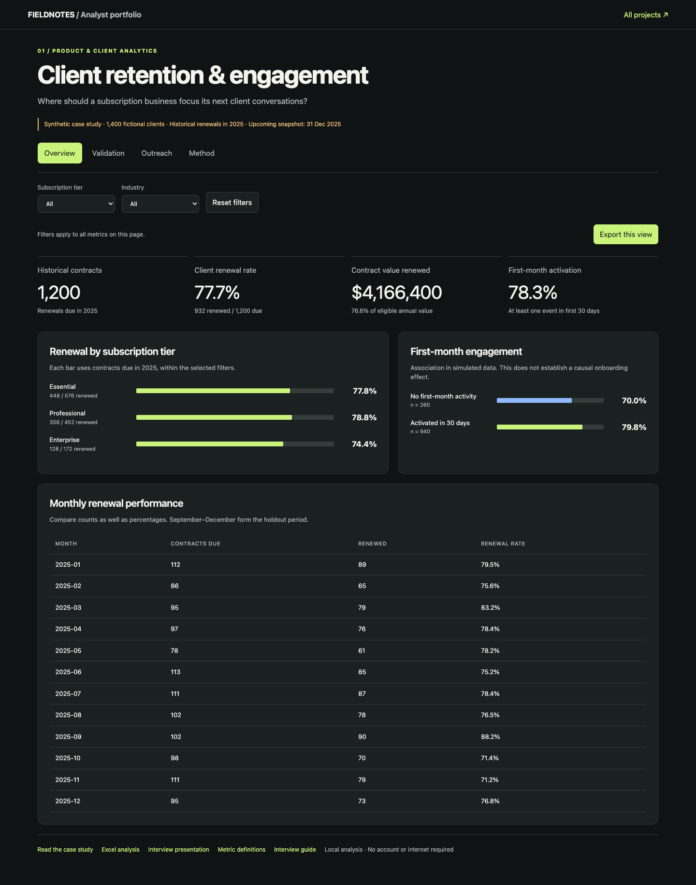

# Client Retention & Engagement

[Case study](case-study.md) · [Metric dictionary](metrics.md) · [SQL walkthrough](walkthrough.ipynb) · [Excel workbook](analysis.xlsx) · [Interview slides](interview.pptx)

Download this repository and open `dashboard.html` in a browser to use the interactive filters and CSV exports. No server or account is required.

## Decision and audience
An account-management lead at a fictional research subscription platform has limited time for outreach. Which clients should receive attention before renewal? This is a synthetic case study, not analysis of Gartner clients.

## Scope
- 1,400 fictional clients, 1,200 historical contracts and 200 upcoming contracts.
- 130,148 activity events across research reads, webinars and expert sessions.
- Fixed seed 113297. One annual contract per account; no expansion, contraction or repeat renewal modelling.
- USD denotes hypothetical annual contract value, not recognised revenue or profit.

## Method
Four tables feed SQLite views. Activity and support facts aggregate independently before joining contracts. Feature snapshots use only information known 60 days before renewal. Jan–Aug 2025 renewals train the model (n=794); Sep–Dec form the holdout (n=406). Each client appears in only one cohort.

The transparent rule flags zero activity over 30 days, at least two open support requests, or a 40% activity decline from at least five prior events with no expert session in 60 days. A five-feature, L2-regularised logistic model provides an interpretable ranking comparison. Training-set means and standard deviations scale its features. Hyperparameters are fixed, and no holdout outcome is used for fitting or selecting features.

## Findings
1. **77.7% of historical clients renewed**: 931 of 1,200 contracts. Renewed annual value is $4,166,400 / $5,440,800 eligible, or 76.6%.
2. The rule finds **45 of 94 holdout non-renewals**. It flags 116 accounts, including 71 that renew. Precision is 38.8%; recall is 47.9%.
3. At **81 outreach slots**, the model captures 32 non-renewals (39.5% precision). Rule-first, then highest contract value captures 35 (43.2%). Random selection would have an expected 23.2% non-renewal share. This single simulated holdout does not prove superiority or actual campaign impact.
4. The model's AUC is **0.670**. Its fixed 0.5 probability threshold catches only 2 non-renewals, illustrating why accuracy or a default threshold alone is a poor business decision criterion.
5. The upcoming queue flags **53 accounts** representing $205,200 of annual contract exposure. This is not predicted recoverable revenue.

## Recommendation and rollout proposal
Start with human review of rule explanations. Confirm that ticket and activity data are complete, then test a fixed outreach script on a random subset of comparable flagged accounts. Keep a usual-service control group. Record time spent and complaints. At maturity, compare renewal rates with confidence intervals and contribution economics. Choose an effect size and sample size before the real experiment. No experiment was run in this portfolio.

## Limitations
The generator embeds noisy engagement and renewal relationships; these findings cannot validate real customer behaviour. Scores are uncalibrated simulation estimates. The contract-value ranking is a priority heuristic, not an estimate of incremental benefit. No real retention improvement or savings were measured. Model performance may shift across renewal periods.

## Presentation route
Open dashboard.html: Overview → Validation → Outreach → Method. Show a filter, explain one denominator, inspect a false positive and finish with the proposed experiment.
