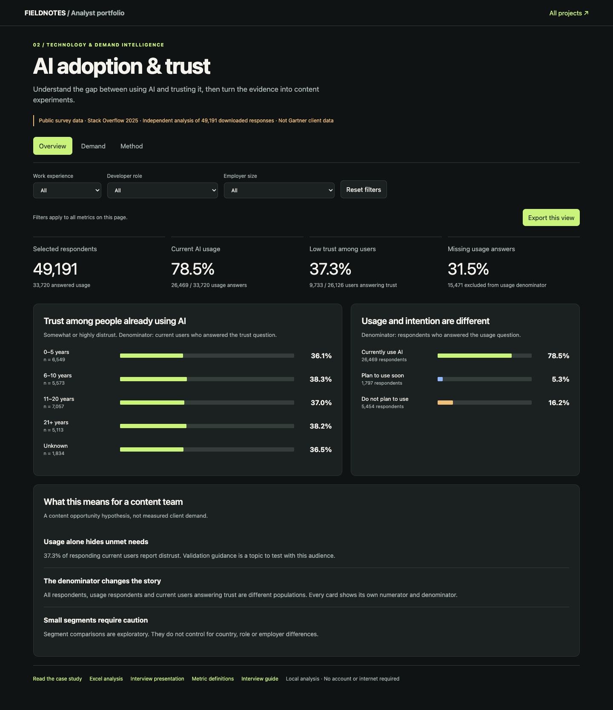

# AI Adoption & Trust Intelligence

[Case study](case-study.md) · [Metric dictionary](metrics.md) · [SQL walkthrough](walkthrough.ipynb) · [Excel workbook](analysis.xlsx) · [Interview slides](interview.pptx)

Download this repository and open `dashboard.html` in a browser to use the interactive filters and CSV exports. No server or account is required.

## Decision and audience
A technology-content team wants to identify audiences and practical AI topics worth testing. The study analyses developer survey responses as an external signal, not as Gartner client demand.

## Source and scope
[Stack Overflow 2025 Developer Survey](https://survey.stackoverflow.co/2025/), downloaded 30 September 2026 from the publisher's [official repository](https://github.com/StackExchange/Survey/tree/main/packages/archive/2025). The survey ran 29 May–23 June 2025. Recruitment primarily used Stack Overflow channels. See the [methodology](https://survey.stackoverflow.co/2025/methodology).

The downloaded file contains **49,191 rows**, while the methodology reports 49,009 retained responses. The 182-row discrepancy remains unresolved. We do not invent an exclusion rule. All results here describe this downloaded file and explicit question-level populations. SOURCE.json records SHA-256 and retrieval details.

## Method
Validate unique respondent IDs and allowed answer categories. Preserve missing answers. Separate current AI usage from planned use. Define low trust as Somewhat distrust or Highly distrust; keep neutral answers in the denominator. Analyse low trust only among current users answering the trust question. Preserve blank work experience as Unknown because the questionnaire tells zero-experience respondents to leave it blank. Split frustration responses into a respondent/category bridge table and deduplicate selections.

## Findings
1. **78.5% currently use AI** among 33,720 respondents answering usage: 26,469 current users. Another 1,797 plan to use it soon. Current-or-planned usage is 83.8%, which should not be described as current usage.
2. **37.3% of responding current users report distrust**: 9,733 / 26,126. This does not share the denominator of the website's overall trust statistic.
3. **15,471 respondents have no usage answer** (31.5% of downloaded rows). Treating those answers as No would depress the adoption rate incorrectly.
4. The most frequently selected frustration among responding current users is **AI solutions that are almost right, but not quite**, selected by 18,584 / 24,827 (74.9%). Multiple selections mean shares need not add to 100%.

## Recommended content experiments
- Test an answer-verification guide with current users who distrust outputs. Measure usefulness and completion before inferring demand.
- Test a debugging workshop with developers reporting debugging friction. Use a controlled exercise to measure task time, while recording code correctness.
- Test an explanation-focused session with developers reporting difficulty understanding generated code. Use a short comprehension assessment.

Audience segment percentages are descriptive; compare denominator sizes and nonresponse before prioritising. Prefer segments with at least 100 current users answering trust for exploratory comparisons. This is a reporting convention, not a power calculation or statistical validity guarantee.

## Limits and next evidence
Self-selection and missing answers constrain generalisation. Employer size describes a respondent's employer, not a sampled company. Multiple respondents may share an employer. Wilson intervals are descriptive and do not remove selection bias. Associations do not prove causation. Validate hypotheses with a consented audience study and actual content engagement before allocating a material budget. No LLM or sentiment model is needed to relabel the questionnaire's existing categories.

## License
Stack Overflow survey database: ODbL 1.0; contents: DbCL 1.0. Derived survey data retains these terms and attribution. Source and transformation scripts accompany this work.
